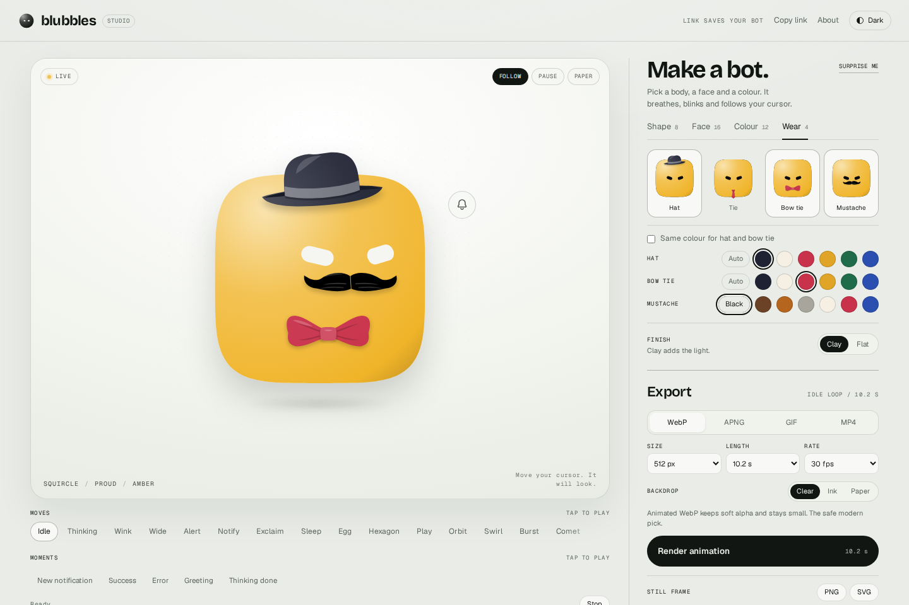
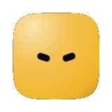

# Blubbles Studio

Animated clay bot avatars you can actually keep.

Each avatar is drawn by a deterministic sampler. A still PNG or SVG only captures one frame; this project replays the sampler, wraps it in a studio, and exports the animation in formats you can upload.

| The studio | The result |
| --- | --- |
|  |  |

## Run it

```bash
npm install
npm start
# compiles src/ to dist/, then serves http://127.0.0.1:4300
```

Node 20 or newer. `npm start` runs `npm run build` first; use `npm run build` on its own
after editing the engine, and `npm test` to build and run every check. Animated exports
also need `ffmpeg` on your PATH; stills do not.

If port 4300 is busy: `PORT=4310 npm start`. To use it from another device on your network: `HOST=0.0.0.0 npm start`.

## What you can do

- Pick one of 8 bodies, 16 faces and 12 colours, or type any hex colour.
- Switch between Clay (soft gradient) and Flat (solid) finishes.
- Preview on Paper, Ink, or a checkerboard that shows real transparency.
- The bot follows your cursor, blinks, breathes, and drifts. 15 moves are playable from the strip under the stage.
- Your choices live in the URL, so the link is the save file.
- Export an idle loop as WebP, APNG, GIF or MP4, or take a still as PNG or SVG.

## Export formats

From the demo bot: 512 px at 30 fps for WebP, APNG and MP4, 256 px at 24 fps for the GIF. Sizes vary with the bot.

| Format | Alpha | Demo size | Notes |
| --- | --- | --- | --- |
| Animated WebP | Yes | 2.2 MB | Best all rounder. Soft alpha, modern browsers, small. |
| APNG | Yes | 7.0 MB | Lossless with full alpha. Heavier but pixel perfect. |
| GIF | 1-bit | 2.7 MB at 256 px | Works almost everywhere. Hard edges and heavy at 512 px. |
| MP4 | No | 0.12 MB | Plays everywhere, renders on Ink or Paper. Good for a profile video. |
| PNG | Yes | 66 KB | Current frame, transparent background by default. |
| SVG | Yes | 6 KB | Current frame, standalone, no CSS variables. |

Some platforms refuse animated avatars no matter the file. No format can fix that. For the ones that accept motion, WebP is the first thing to try.

## Command line

The same engine and encoder are available without the browser:

```bash
npm run avatar -- --shape cloud --face curious --color violet --format webp --size 512
npm run avatar -- --shape pebble --face happy --color 3b93f0 --format gif --size 256 --duration 6.8
npm run avatar -- --format png --size 1024 --bg transparent
```

Useful flags:

```
--shape     circle | pebble | squircle | capsule | triangle | hexagon | cloud | droplet
--face      neutral | attentive | surprised | excited | happy | laughing | angry | sad |
            scared | suspicious | confused | curious | proud | shy | unimpressed | sleepy
--color     ink | cream | brown | red | orange | amber | green | turquoise | blue |
            purple | pink | grey | 3b93f0
--finish    clay | flat
--format    webp | apng | gif | mp4 | png | svg
--size      64 .. 2048
--fps       1 .. 60
--duration  6.8 | 10.2 | 13.6
--bg        transparent | ink | paper | rrggbb
--time      seconds, stills only
--out       output path
--list      print all options
```

## Use it in your own UI

The browser package is one function: `createBlub`. It mounts into an element or a CSS
selector, shares one animation loop with every other blub, and takes commands from UI
events, a websocket or an LLM tool call.

```bash
npm install blubbles
```

```js
import { createBlub } from 'blubbles';

const blub = createBlub('#bot', { shape: 'cloud', face: 'happy', color: '#7c5cff', size: 96 });
await blub.play('wink');              // one-shot; resolves when it ends
blub.status('thinking');              // looping; holds until changed
blub.set({ face: 'excited', color: 'pink', shape: 'pebble' });
blub.lookAt({ x: 640, y: 320 });      // page coordinates, or { yaw, pitch }
blub.follow('pointer');               // eyes track the cursor; follow(null) stops
blub.destroy();
```

`blub.state` is a frozen snapshot: `{ shape, face, color, finish, status, action }`.
`on('change', …)` fires whenever it changes. Every method is documented with defaults
and units (seconds, degrees, CSS pixels) in the TypeScript types.

### Commands over a websocket

Commands are plain JSON, so a server, a remote control or a websocket can drive the
same avatar:

```js
import { createBlub } from 'blubbles';

const blub = createBlub('#bot', { shape: 'cloud', face: 'happy' });

socket.addEventListener('message', (event) => {
  try {
    blub.send(JSON.parse(event.data));
  } catch (error) {
    console.warn(error.message); // names the bad value and the valid ones
  }
});

// in another process
socket.send(JSON.stringify({ type: 'play', action: 'wink' }));
socket.send(JSON.stringify({ type: 'set', color: 'pink', face: 'excited' }));
socket.send(JSON.stringify({ type: 'status', status: 'sleeping' }));
```

`send` also accepts an array; commands are validated before any of them apply. See
`BlubCommand` for the union and `commandSchema` for the JSON Schema.

### An LLM tool call

`commandSchema` is a JSON Schema for `BlubCommand`. Pass it straight to a model as a
tool definition, then hand the parsed arguments to `send`:

```js
import { commandSchema, createBlub } from 'blubbles';

const blub = createBlub('#bot', { shape: 'pebble', face: 'happy', color: 'amber' });

const tools = [{
  type: 'function',
  function: {
    name: 'control_blub',
    description: 'Pose the avatar. Use one command per call.',
    parameters: commandSchema,
  },
}];

// Later, with the tool call returned by the model:
function onToolCall(call) {
  blub.send(JSON.parse(call.function.arguments));
}
```

### React

`createBlub` accepts an `AbortSignal`, which is the one-liner for `useEffect` cleanup:

```jsx
import { useEffect, useRef } from 'react';
import { createBlub } from 'blubbles';

export function BlubAvatar({ shape = 'cloud', face = 'happy', color = 'blue', size = 96 }) {
  const host = useRef(null);

  useEffect(() => {
    const controller = new AbortController();
    createBlub(host.current, { shape, face, color, size, signal: controller.signal });
    return () => controller.abort();
  }, [shape, face, color, size]);

  return <div ref={host} style={{ width: size, height: size }} />;
}
```

### Advanced: own the clock, or render a string

For a custom loop or a canvas/video pipeline, use the manual clock on the same object:

```js
import { createBlub } from 'blubbles';

const blub = createBlub('#bot', { clock: 'manual', fps: 30, shape: 'cloud' });
blub.render(0);                 // absolute seconds
blub.tick(1 / 30);              // or advance by a delta
```

The raw layer lives on a subpath, so it does not crowd the main import. It has no DOM
requirement, which makes it the Node/SSR path:

```js
import { BlubEngine, renderBlubSVG, renderSampleSVG } from 'blubbles/engine';

// One string, no engine handling:
const svg = renderBlubSVG({ shape: 'pebble', face: 'happy', color: 'blue', size: 512 });

// Or own the frame:
const engine = new BlubEngine();
const frame = renderSampleSVG(engine.sample(1.2), { size: 512, paper: '#ffffff' });
```

### Vocabulary

Statuses hold a looping pose until the next `status()` or `play()`:

| Status | Engine state | What it looks like |
| --- | --- | --- |
| `idle` | `idle` | Resting face, ambient wander and blinks. |
| `thinking` | `thinking` | Three dots drift in a slow wave. |
| `listening` | `wide` | Wide-eyed, attentive hold. |
| `sleeping` | `sleep` | Eyes closed, slow breathing. |
| `alert` | `alert` | Stretched body with an exclamation mark. |

Actions are one-shot; `play()` resolves with `{ status: 'completed' | 'interrupted' | 'cancelled' }`:

| Action | Engine state | What it does |
| --- | --- | --- |
| `wink` | `wink` | Quick wink and return. |
| `notify` | `notify` | A notification badge pops onto the body. |
| `exclaim` | `exclaim` | The body turns into an exclamation mark. |
| `hatch` | `egg` | Curls into an egg shape. |
| `crystallize` | `hexagon` | Snaps into a hexagonal crystal. |
| `celebrate` | `play` | Triangle body with swoosh ribbons. |
| `orbit` | `orbit` | Six rings orbit the body. |
| `swirl` | `swirl` | Three ribbons swirl past. |
| `burst` | `burst` | The body shrinks and releases particles. |
| `comet` | `comet` | Comet ribbons stream across. |

`SHAPES`, `FACES`, `COLORS`, `ACTIONS` and `STATUSES` are exported for pickers.
`COLORS` maps each named colour to its hex value.

### Customization

**Clay intensity.** `clay` scales the gradient highlight and shadow (0 = none,
1 = the default look, 2 = the strongest). `light` moves the highlight centre in unit
body coordinates:

```js
const blub = createBlub('#bot', {
  clay: { highlight: 1.4, shadow: 0.6, light: { x: -0.2, y: -0.5 } },
});
blub.set({ clay: 0.6 });                 // number shorthand scales both
blub.set({ clay: { highlight: 2 } });    // partial: merges with the current target
```

`finish: 'flat'` is sugar for a solid fill. `clay: 0` keeps the gradient node but every
stop is the body colour; it rasterises identically to `finish: 'flat'` (the markup
differs).

**Colour transitions.** Colour, paper, eye and clay changes animate over 0.4 s by
default, mixed in OKLab so blue -> yellow does not pass through grey. A new change
mid-transition starts from what is on screen. `state.color` is the target; `change`
fires once per `set()`.

```js
const blub = createBlub('#bot', { transition: { duration: 0.2 }, color: 'blue' });
blub.set({ color: 'pink' });                                  // 0.2 s
blub.set({ color: '#ff0', clay: 0.6 }, { duration: 0.8 });    // 0.8 s
blub.set({ eye: 'auto', paper: '#ffffff' }, { duration: 0 }); // instant
```

**Follow radius.** With no options the eyes follow anywhere on the page. A radius adds
hysteresis: enter at `radius`, leave beyond `exitRadius` (default `radius * 1.25`), so
the gaze does not flicker when the cursor sits on the edge. `'element'` follows only
inside the blub's box. Enter/leave move smoothly through the engine's look easing.

```js
const offEnter = blub.on('follow:enter', () => console.log('in'));
const offLeave = blub.on('follow:leave', () => console.log('out'));

blub.follow('pointer', { radius: 240, exitRadius: 300, onLeave: 'previous' });
blub.follow('pointer', { radius: 'element' });
blub.follow('pointer');
blub.follow(null);
```

`onLeave` is `'previous'` (restore the gaze from before following), `'wander'` (ambient
wander) or `'center'`. The element rect is cached and refreshed on scroll/resize, not
on every pointer move; touch and pen follow only during an active drag.

### What it looks at

`follow` accepts one target, an ordered list, or a per-frame function. Targets:
`'pointer'`, `'focus'` (the focused element), `'caret'` (the text caret in an input
or textarea), an `Element`, a CSS selector, another blub, or `() => ({ x, y }) | null`.
A target that is missing, hidden, disconnected or outside its radius is skipped.

```js
// First active target wins; a plain string array gets descending weights.
blub.follow(['caret', 'focus', 'pointer'], { switchMargin: 0.1, minHold: 0.25 });

// Explicit weights: 0 ignores, 1 is top priority.
blub.follow([
  { target: 'caret', weight: 1 },
  { target: document.querySelector('#chat'), weight: 0.6 },
  { target: 'pointer', weight: 0.3 },
]);

// Mixed arrays are fine; plain entries take their weight from their position.
blub.follow(['caret', { target: document.querySelector('#chat'), weight: 0.6 }, 'pointer']);

// Or compute the list every frame. ctx is reused; keep this cheap and allocation-free.
blub.follow((ctx) => [
  { target: 'pointer', weight: ctx.pointer.speed > 800 ? 0.9 : 0.2 },
  { target: '#badge', weight: unread ? 0.8 : 0 },
]);
```

`pick: 'strongest'` (default) looks at the highest-weighted active target. It only
switches when a rival beats the current one by `switchMargin` for at least `minHold`
seconds, which stops the eyes darting between near-equal targets. `pick: 'blend'` averages
the active look directions by weight for divided attention.

Every entry also takes `radius`, `exitRadius`, `onLeave`, `speed`, `range` (degrees),
`mode: 'look' | 'avoid'` and `delay` (seconds). `speed` scales the gaze catch-up, `delay`
adds reaction lag, and `range` clamps the final direction. `on('follow:target', …)` fires
when the chosen target changes; `follow:enter`/`follow:leave` mark the start and end of
tracking. In `blend` mode there is no single winner, so `follow:target` is not emitted.

The `ctx` passed to a dynamic function is the same read-only object each frame (do not
store it past the call). It carries `time`/`dt`, `blub` (`rect`, `center`, `status`,
`action`, `face`, `visible`), `pointer` (`x`, `y`, `speed`, `distance`, `inside`,
`active`, `idle`, `down`, `type`), `focus` (`el`, `typing`, `idle`), `caret`, `current`
(`target`, `weight`, `since`), the current `gaze`, and a cached `measure(el)` helper
that never forces layout. All targets are cleaned up by `destroy()`/`signal`; elements
are measured with `ResizeObserver`/`IntersectionObserver` and only re-read after
scroll/resize.

### Moments

**The one rule:** chained calls run one after another. Everything inside a single
`.do({...})` (or one JSON beat) runs together, at most one of each kind. There is no
`.then()`.

```js
await blub.moment()
  .do({ face: 'surprised', look: bellEl, play: 'notify' }) // one beat, all together
  .wait(0.4)
  .face('happy')                                            // next beat
  .follow('pointer')
  .run();
```

The same moment as JSON, with parameters and named presets:

```js
blub.define('newNotif', [
  { face: 'surprised', look: '#bell', play: 'notify' },
  { wait: 0.4 },
  { face: 'happy', hold: 0.6 },
]);

blub.define('greet', (params) => [
  { face: params.face ?? 'happy', play: 'wink' },
  { hold: 0.4 },
]);

await blub.run('newNotif');
await blub.run('greet', { face: 'excited' });

// Keep the end state instead of restoring. The hold makes the last beat visible:
// restore runs as soon as the last beat ends.
blub.define('point', [{ face: 'happy', follow: 'pointer' }], { restore: false });
await blub.run('point');
```

Built-in presets (global, overridable): `newNotification({ target })`, `success`,
`error`, `greeting`, `thinkingDone`. A beat with `play` lasts until the action ends;
otherwise it is instant. `hold` adds a minimum duration, `wait` is an empty held beat,
and `cue: { ...beat, at: seconds }` applies a change inside the same beat (no `play`
or `cue` in a cue). `blub.define(name, def)` overrides per blub; `defineMoment(name,
def)` is the global registry.

`run()` resolves `{ status: 'completed' | 'interrupted' | 'cancelled' }`. A new run
stops the current one and restores its snapshot before starting; pass `{ queue: true }` to
wait instead. `blub.stop()` cancels the action that run started too, and `{ signal }` is
supported. `define(name, def, { restore })` and `defineMoment(name, def, { restore })`
set the definition default. Named presets restore the face, status and gaze/follow from
before the moment by default (ad-hoc chains do not); `restore: 'all'` also restores
shape/colour/clay. Restore runs as soon as the last beat ends, so give that beat a
`hold` if it should be seen. Events: `moment:start { name }`, `moment:beat { name, index }`,
`moment:end { name, status }`. Commands add `{ type: 'run' }`, `{ type: 'stop' }` and
`{ type: 'define' }` to `BlubCommand`/`commandSchema`; the JSON fields are
`run.moment`, `run.params` and `define.beats`.

### Many avatars

All auto-clock blubs share one `requestAnimationFrame` loop, the loop stops when the
last one is paused or destroyed, and rendering is skipped while an avatar is off-screen
or the tab is hidden (engine time keeps advancing). For grids, set `fps: 30` and a
small `size`; each blub also needs a sized container.

### Performance

Measured on this machine (Node 24 for import/frame cost, Chrome via
`npm run verify:dom` for the browser numbers):

- Importing `blubbles`: ~22-29 ms cold in Node (was ~113 ms before lazy eye-clearance
  tables). A bundled copy of the same entry imports in ~5-9 ms; the rest is Node's
  per-module ESM loading.
- Minified + gzipped: `blubbles` 28.4 KB, `blubbles/engine` 12.3 KB.
- `BlubEngine.sample(t)`: 86.0 µs/frame; heap growth 0.00 MB over 10,000 frames.
- 50 blubs, 60 manual frames: 4.05 ms/frame total, 81 µs per blub-frame.
- 1,000 create/destroy cycles: heap growth 0.00 MB after GC, zero scheduler
  subscribers, zero pointer listeners and zero SVG elements left.
- `finish: 'flat'` and `clay: 0` rasterise to identical PNG bytes; only the SVG
  markup differs (flat fills with the colour, clay-0 uses an all-one-colour gradient).

Run `npm run bench` for the engine frame cost; `npm run verify:dom` also runs the SDK,
leak and 50-blub perf checks in Chrome.

## Accessories

A blub can wear one thing each on its head, neck and lip: `hat`, `tie` or `bowtie`, and
`mustache`.

```ts
const blub = createBlub(el, { shape: 'pebble', accessories: ['hat', 'bowtie'] });
blub.set({ accessories: ['hat', { id: 'tie', color: '#c8324a' }] }); // tie arrives, bow leaves
blub.set({ accessories: [] });                                       // everything comes off
```

Without a `color`, an accessory takes a deep tone from the body colour, except a mustache, which
is black (cream on a very dark body). They are drawn from
the body each frame: a hat finds where it fits on the head, and front pieces turn with the
gaze, keep clear of the eyes and follow through with a spring. A tie hangs off the bottom of the
body and swings free. `accessories` also
works in `renderBlubSVG`, a `set` command and a moment beat. A blub that wears nothing draws
exactly what it drew before.

## Regression check

`npm run verify` re-renders one known frame (pebble, happy, blue at `t = 1.64968`) and
compares it with `research/golden.json.gz`: the body path, both eye matrices, all four clay
gradient stops, and the full SVG must match exactly.

```bash
npm run verify
# ok  body path
# ok  eye matrices
# ok  gradient stops
# ok  full SVG
```

`npm run verify:golden` is the exhaustive version: it compares 1,800 engine samples
(every state x shape x face at five times), morph timelines, catalogs and ten SVG
renders byte for byte. The reference is gzipped (about 0.8 MB) with `node:zlib`, so it
stays cheap to keep in the repo.

`npm run snapshot` regenerates that reference from the current `dist/` build. Run it
only after an intentional visual change: the golden file is the behaviour contract, and
regenerating it accepts whatever the current code draws.

Details and loop timings are in `research/NOTES.md`.

## How the renderer works

The avatar is not a sprite sheet or a video. It is a pure function of time.

- A body is 64 radii around a circle, morphed between eight shapes. The path is a Catmull-Rom spline converted to cubic Béziers with tension 1/6.
- Eyes are rounded rectangles projected onto a sphere using yaw, pitch and roll, then tilted and squashed to follow the surface. A mask cuts them out of the body, so they read as holes rather than stickers.
- The body is filled with the paper colour, then a radial clay gradient is masked over it. The eyes are cut-outs that show the paper beneath, so they read as holes rather than stickers.
- `BlubEngine.sample(t)` layers the pose with ambient wander (sums of incommensurate sines), a seeded blink schedule, a 3.4 s breath, and a small drift. 15 states can morph in and out with quintic easing.
- Animated exports sample every frame and rasterise; a single-frame SVG clone would not capture motion.

The loop lengths are 6.8, 10.2 and 13.6 seconds: two, three and four breath cycles. Start times are chosen to land between blinks and to minimise the seam. The 10.2 s loop's first and last frames differ by about one pixel at 512 px.

## Project map

```
src/math/              TAU, clamp, lerp, easings, loopNoise, mulberry32, hsl, mixHex
src/geometry/          64-point silhouettes, ray casting, smooth union, path building
src/catalog/           shapes, colours, expressions, states and poses (data only)
src/engine/            BlubEngine, morph clocks, eyes, body, decorations, ambient motion
src/render/svg.ts      sample -> standalone SVG string (raw layer only)
src/palette.ts         palette and the autoEye contrast rule
src/names.ts           English ids, legacy French ids, colour lookup
src/sdk/commands.ts    vocabulary, command union, validation, commandSchema
src/sdk/core.ts        status/action queue, promises and events (DOM-free)
src/internal/model.ts  style + engine model used by createBlub (private)
src/internal/view.ts   SVG DOM view with per-attribute write cache (private)
src/internal/scheduler.ts  one shared requestAnimationFrame loop (private)
src/internal/pointer.ts    one shared passive pointermove listener (private)
src/internal/follow-gate.ts  radius hysteresis for pointer following
src/internal/follow-inputs.ts  shared pointer/focus/caret state
src/internal/follow-select.ts  priority, margin/minHold and blend maths
src/internal/follow-controller.ts  target resolution and follow events
src/internal/element-metrics.ts  Resize/IntersectionObserver rect cache
src/internal/style-transition.ts  colour/clay/eye/paper interpolation
src/sdk/clay.ts        clay intensity types, clamp and merge
src/sdk/moments.ts    beats, builder, registry and built-in presets
src/sdk/moment-helpers.ts   small colour helper for moment beats
src/internal/moment-runner.ts  clock-driven moment scheduler
src/oklab.ts           perceptual colour mixing
src/blub.ts            createBlub: mounting, clock, accessibility, lifecycle
src/index.ts           main entry: createBlub, types, lists, commandSchema
src/engine-entry.ts    "blubbles/engine": BlubEngine + renderBlubSVG
scripts/               snapshot.mjs, verify-golden.mjs, bench.mjs
test/                  node:test SDK tests
dist/                  tsc output: JS and .d.ts (generated, gitignored)
catalog.mjs            studio URL helpers and picker options
export.mjs             frame rendering and ffmpeg encoding
server.mjs             static server + export job API
make-avatar.mjs        command line generator
verify.mjs             focused golden-snapshot check
verify-dom.mjs         DOM/SDK/leak/perf browser check (npm run verify:dom)
studio/                the UI: index.html, style.css, app.js, self-hosted fonts
research/              golden.json.gz and renderer notes (NOTES.md)
out/                   generated demo exports (gitignored)
```

The server only writes inside `.work/` while a job runs, and clears old jobs after 30 minutes. Nothing is uploaded anywhere.

## Licence

Blubbles is released under the MIT Licence; see [LICENSE](LICENSE). Third-party notices,
including the MIT notice for Jérémy Perret's [bloub](https://github.com/jeremy-prt/bloub),
are in [THIRD_PARTY_NOTICES.md](THIRD_PARTY_NOTICES.md).

## Credit

The blub character design is credited to Jeremy Perret. He is not officially affiliated with Grok bot. The MIT notice for his [bloub](https://github.com/jeremy-prt/bloub) project is in [THIRD_PARTY_NOTICES.md](THIRD_PARTY_NOTICES.md).

No accounts, no analytics, no third-party requests at runtime. Fonts are self-hosted (Bricolage Grotesque, Geist, Geist Mono, all OFL).
